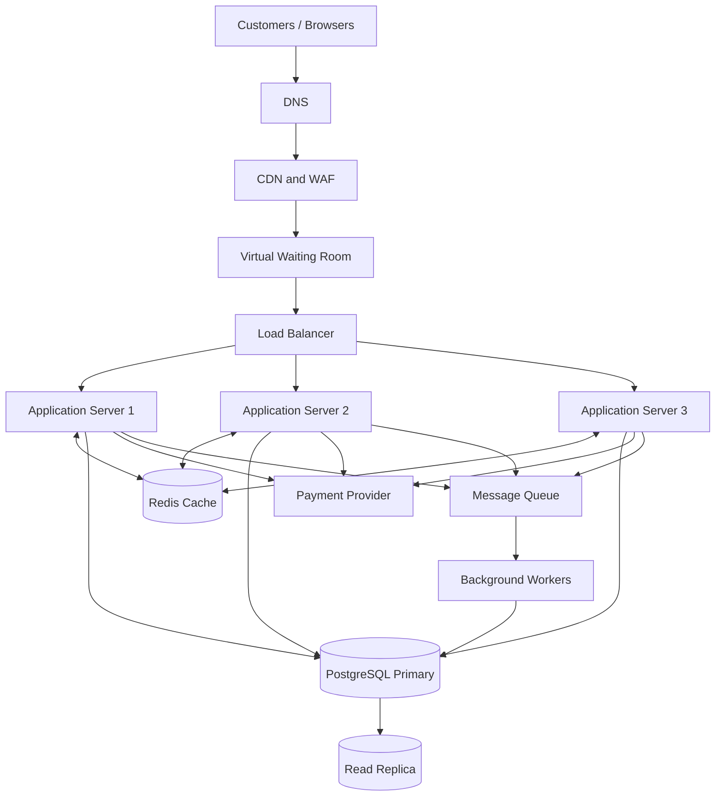

# TicketHub — System Design Document

## 1. Requirements

TicketHub is an online ticketing platform where customers can discover events, select seats, purchase tickets, and view their bookings.

### 1.1 Functional requirements

1. Users can register, log in, and manage their accounts.
2. Users can browse upcoming concerts and events.
3. Users can view event details, ticket prices, and available seats.
4. Users can select and temporarily hold available seats.
5. Users can pay for reserved tickets using a payment provider.
6. Users can view their purchased tickets and booking history.
7. Administrators can create, update, and manage events.
8. The system sends booking confirmations after successful payments.

### 1.2 Non-functional requirements

**Performance**
- Event pages should load within 2 seconds under normal conditions.
- API responses should generally be below 300 milliseconds, excluding external payment processing.
- The system must handle thousands of simultaneous requests during popular ticket sales.

**Correctness**
- A seat must never be sold to two different customers.
- Payments must be processed safely without creating duplicate orders.
- Booking information must remain consistent across the application.

**Fairness**
- Customers should be served through a virtual waiting room during major ticket releases.
- The system should use queue tokens to control access.
- Automated bots and repeated requests should be limited using rate limiting.
- Customers should receive equal opportunities to purchase available tickets.

**Availability and security**
- The system should target 99.9% availability.
- All communication must use HTTPS.
- Passwords must be securely hashed.
- Users must only access their own orders and tickets.
- Database backups and recovery procedures must be maintained.

---

## 2. Traffic and Storage Estimates

TicketHub has 2 million registered users.

### 2.1 Normal traffic

Given:
- Registered users: 2,000,000
- Daily visitors: 50,000
- Pages viewed per visitor: 10
- Daily ticket sales: 5,000
- Seconds per day: 86,400

Daily page views:

50,000 × 10 = 500,000 page views.

Average page requests per second:

500,000 / 86,400 = 5.79 requests per second.

Daily ticket sales:

5,000 tickets per day.

Average ticket sales per second:

5,000 / 86,400 = 0.058 tickets per second.

For planning, the system should also handle approximately 10 times the average traffic during normal busy periods, or about 58 page requests per second.

### 2.2 Popular concert sale traffic

Given:
- Customers attempting to purchase: 200,000
- Available seats: 20,000
- Sale duration: 10 minutes (600 seconds).

Average purchase attempts per second:

200,000 / 600 = 333.33 attempts per second.

Demand-to-supply ratio:

200,000 / 20,000 = 10 customers per seat.

Only 10% of customers can obtain a seat if every customer attempts to buy one seat.

For capacity planning, assume each customer makes approximately four API requests during the purchase process:

- View event information.
- View available seats.
- Hold a seat.
- Initiate payment.

Estimated peak API traffic:

333.33 × 4 = approximately 1,333 requests per second.

The infrastructure should be tested for at least five times this estimated average peak:

1,333 × 5 = approximately 6,665 requests per second.

| Metric | Normal day | Popular concert sale |
|---|---:|---:|
| Visitors / purchase attempts | 50,000 daily | 200,000 in 10 minutes |
| Page views | 500,000 daily | High concentrated demand |
| Average request rate | 5.79 RPS | 1,333 API RPS (estimated) |
| Available seats | Depends on event | 20,000 |
| Ticket sales | 5,000 daily | Maximum 20,000 seats |
| Main challenge | Regular traffic | Overload and seat contention |

The big sale is much more demanding because many customers arrive within a short period. The system must control traffic and protect the database from simultaneous seat reservations.

---

## 3. API Design

The TicketHub backend will expose REST API endpoints using HTTPS and JSON.

| Method | Endpoint | Description | Success status |
|---|---|---|---|
| GET | /api/v1/events | List available events | 200 OK |
| GET | /api/v1/events/{id} | View event details | 200 OK |
| GET | /api/v1/events/{id}/seats | View available seats | 200 OK |
| POST | /api/v1/seat-holds | Temporarily reserve a seat | 201 Created |
| DELETE | /api/v1/seat-holds/{id} | Release a seat hold | 204 No Content |
| POST | /api/v1/orders/{id}/payment | Process order payment | 200 OK |
| GET | /api/v1/me/tickets | View purchased tickets | 200 OK |

### Example: View events

Request:

GET /api/v1/events

Response:

```json
{
  "events": [
    {
      "id": 101,
      "name": "Summer Music Festival",
      "venue": "City Stadium",
      "date": "2027-02-15",
      "ticket_price": 2500
    }
  ]
}
```

### Example: Hold a seat

Request:

POST /api/v1/seat-holds

```json
{
  "event_id": 101,
  "seat_id": 501
}
```

Response:

```json
{
  "hold_id": 9001,
  "seat_id": 501,
  "status": "HELD",
  "expires_at": "2027-02-15T10:05:00Z"
}
```

If another customer has already held the seat, the API returns:

409 Conflict

```json
{
  "error": "This seat is no longer available."
}
```

### Example: Payment

Request:

POST /api/v1/orders/9001/payment

```json
{
  "payment_method": "card",
  "idempotency_key": "payment-9001-unique"
}
```

Response:

```json
{
  "order_id": 9001,
  "status": "PAID",
  "message": "Payment completed successfully."
}
```

The payment endpoint must use idempotency keys to prevent duplicate charges when customers retry requests.

---

## 4. Database Design

TicketHub will use PostgreSQL because the application requires reliable transactions, relationships, and strong data consistency.

### 4.1 Users table

Stores customer account information.

| Column | Type | Key |
|---|---|---|
| id | UUID | Primary Key |
| name | VARCHAR(100) | |
| email | VARCHAR(255) | Unique |
| password_hash | TEXT | |
| created_at | TIMESTAMP | |

### 4.2 Events table

Stores information about concerts and other events.

| Column | Type | Key |
|---|---|---|
| id | UUID | Primary Key |
| name | VARCHAR(200) | |
| description | TEXT | |
| venue | VARCHAR(200) | |
| event_date | TIMESTAMP | |
| created_at | TIMESTAMP | |

### 4.3 Seats table

Stores seats belonging to individual events.

| Column | Type | Key |
|---|---|---|
| id | UUID | Primary Key |
| event_id | UUID | Foreign Key |
| seat_number | VARCHAR(30) | |
| price | DECIMAL(10,2) | |
| status | VARCHAR(20) | |
| held_by_user_id | UUID | Foreign Key, nullable |
| hold_expires_at | TIMESTAMP | Nullable |
| order_id | UUID | Foreign Key, nullable |

A unique constraint on `(event_id, seat_number)` ensures that a physical seat is registered only once for each event.

### 4.4 Orders table

Stores customer purchase information.

| Column | Type | Key |
|---|---|---|
| id | UUID | Primary Key |
| user_id | UUID | Foreign Key |
| total_amount | DECIMAL(10,2) | |
| status | VARCHAR(20) | |
| created_at | TIMESTAMP | |
| paid_at | TIMESTAMP | Nullable |

### 4.5 Relationships

1. One user can create many orders.
2. One event can have many seats.
3. One order can contain multiple seats.
4. Each seat can belong to only one active or completed order at a time.
5. A user can purchase tickets for multiple events.

### 4.6 Example SQL constraints

```sql
CREATE TABLE users (
    id UUID PRIMARY KEY DEFAULT gen_random_uuid(),
    name VARCHAR(100) NOT NULL,
    email VARCHAR(255) UNIQUE NOT NULL,
    password_hash TEXT NOT NULL,
    created_at TIMESTAMPTZ DEFAULT NOW()
);

CREATE TABLE events (
    id UUID PRIMARY KEY DEFAULT gen_random_uuid(),
    name VARCHAR(200) NOT NULL,
    description TEXT,
    venue VARCHAR(200) NOT NULL,
    event_date TIMESTAMPTZ NOT NULL,
    created_at TIMESTAMPTZ DEFAULT NOW()
);

CREATE TABLE orders (
    id UUID PRIMARY KEY DEFAULT gen_random_uuid(),
    user_id UUID NOT NULL REFERENCES users(id),
    total_amount DECIMAL(10,2) NOT NULL,
    status VARCHAR(20) NOT NULL,
    created_at TIMESTAMPTZ DEFAULT NOW(),
    paid_at TIMESTAMPTZ
);

CREATE TABLE seats (
    id UUID PRIMARY KEY DEFAULT gen_random_uuid(),
    event_id UUID NOT NULL REFERENCES events(id),
    seat_number VARCHAR(30) NOT NULL,
    price DECIMAL(10,2) NOT NULL,
    status VARCHAR(20) NOT NULL DEFAULT 'AVAILABLE',
    held_by_user_id UUID REFERENCES users(id),
    hold_expires_at TIMESTAMPTZ,
    order_id UUID REFERENCES orders(id),
    UNIQUE (event_id, seat_number)
);
```

### 4.7 Preventing double-booking

Preventing two customers from buying the same seat is one of the most important requirements.

TicketHub will use PostgreSQL transactions and row-level locking.

When a customer selects a seat:

1. The application starts a database transaction.
2. It locks the selected seat using `SELECT ... FOR UPDATE`.
3. It checks whether the seat is available or whether its previous hold has expired.
4. If available, it creates a pending order and changes the seat status to HELD.
5. It records the customer and hold expiration time.
6. The transaction commits.

Another customer trying to reserve the same seat must wait for the first transaction to finish. Afterward, the second request checks the updated seat status and receives a 409 Conflict response if the seat is already held.

A simplified conditional update can also protect against competing requests:

```sql
UPDATE seats
SET status = 'HELD',
    held_by_user_id = $1,
    hold_expires_at = NOW() + INTERVAL '5 minutes'
WHERE id = $2
  AND (
      status = 'AVAILABLE'
      OR (
          status = 'HELD'
          AND hold_expires_at < NOW()
      )
  )
RETURNING id;
```

Only one competing request can successfully claim the seat.

After payment is confirmed, the application changes the seat status to SOLD and marks the order as PAID in a transaction.

If payment is not completed within five minutes, a background worker releases the expired hold.

The payment provider's webhook must also be verified and processed idempotently. This prevents duplicate payment notifications from creating duplicate orders or charges.

**The database is the final authority on seat availability, not the frontend or cache.**

---

## 5. System Architecture

### 5.1 Architecture diagram



### 5.2 Component explanations

**1. Customers / Browsers**

Customers use the website to browse events, select seats, and purchase tickets.

**2. DNS**

Translates the TicketHub domain name into the correct server address.

**3. CDN and WAF**

Delivers static content quickly and blocks suspicious traffic, malicious requests, and common attacks.

**4. Virtual Waiting Room**

Controls how many customers enter the ticket purchasing system at once. It maintains an orderly queue and gives customers queue tokens.

**5. Load Balancer**

Distributes incoming requests across healthy application servers.

**6. Application Servers**

Run the business logic and API endpoints. Multiple servers allow the system to handle more customers and continue working if one server fails.

**7. Redis Cache**

Stores frequently accessed event information and seat availability snapshots to reduce unnecessary database reads. It is not the final authority for seat reservations.

**8. PostgreSQL Primary Database**

Stores users, events, seats, and orders. It handles transactions and guarantees that seat reservations remain consistent.

**9. Read Replica**

Handles read-heavy operations such as event information and ticket browsing, reducing pressure on the primary database.

**10. Message Queue**

Stores background jobs such as booking notifications and ticket generation.

**11. Background Workers**

Process queued tasks independently so that the main application does not become overloaded.

**12. Payment Provider**

Processes customer payments and sends verified payment confirmations to TicketHub.

### 5.3 How the system handles a popular concert sale

When 200,000 people try to purchase 20,000 seats, sending every request directly to the database would create unnecessary pressure.

TicketHub handles this through the following process:

1. Customers enter the website through the CDN and WAF.
2. The virtual waiting room controls the number of customers allowed into the purchasing system.
3. Customers receive queue tokens and are admitted in a controlled, fair order.
4. The load balancer distributes requests across multiple application servers.
5. Redis serves frequently requested event and seat information.
6. When a customer requests a seat, the application checks availability in PostgreSQL using a transaction and row-level lock.
7. A successful reservation receives a five-minute temporary hold.
8. The customer completes payment through the payment provider.
9. The application confirms the payment and changes the seat status to SOLD.
10. Background workers generate tickets and send booking confirmations.

This approach prevents thousands of requests from overwhelming the database while maintaining correct seat ownership.

---

## 6. Trade-offs

### Trade-off 1: SQL database versus NoSQL database

PostgreSQL provides strong transactions, relationships, and constraints. These features are important because two customers must never purchase the same seat.

However, a relational database requires careful transaction management and may become a bottleneck during large sales.

**Decision:** Use PostgreSQL because correctness and financial consistency are more important than choosing a database simply because it offers easy horizontal scaling.

### Trade-off 2: Caching versus data consistency

Redis improves performance by reducing repeated database queries.

However, cached seat availability may become outdated when another customer reserves a seat.

**Decision:** Use Redis for browsing and displaying seat availability, but always verify and reserve seats through PostgreSQL transactions.

### Trade-off 3: Fairness versus speed

A virtual waiting room protects the system from sudden traffic spikes.

However, customers may have to wait longer before accessing the purchasing page.

**Decision:** Use a fair queue with queue tokens and controlled admission. This provides a better purchasing experience than allowing everyone to compete simultaneously.

### Trade-off 4: Temporary holds versus customer convenience

Temporary seat holds prevent multiple customers from competing for the same seat during checkout.

However, a five-minute hold may be too short for customers experiencing slow payment processing.

**Decision:** Use a five-minute hold with a clear countdown and provide a controlled extension only when justified. Expired holds must be released safely.

---

## Conclusion

TicketHub requires a system that can handle millions of registered users and sudden increases in traffic during popular ticket releases.

The proposed architecture combines PostgreSQL transactions, Redis caching, load balancing, a virtual waiting room, and background processing.

The most important design decision is using database transactions and row-level locking to prevent double-booking.

By combining performance, fairness, security, and data consistency, TicketHub can provide a reliable ticket purchasing experience even during major concert sales.
